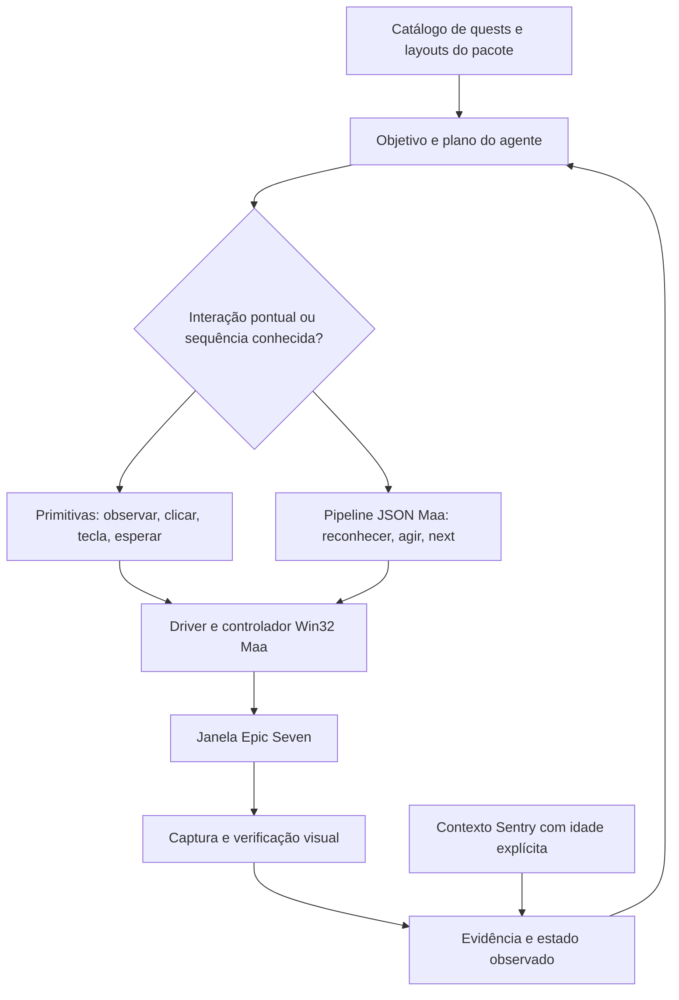

# Arquitetura

Este documento é a fonte técnica canônica. A estrutura padrão é `ui_tree`, produzida em todas as observações públicas e no callback ScreenTarget. Maa reconhece e executa; adaptadores convertem a evidência; consumidores consultam a árvore/projeções. Regras do agente ficam em AGENTS.md, uso no README e evidências em validation.md.

O agente decide o objetivo e pode trabalhar em dois níveis. Uma primitiva resolve uma interação pontual ou explora uma tela nova. Uma rotina encadeia transições estáveis em um pipeline Maa. O uso de uma primitiva não exige criar ou promover uma rotina.



## Componentes

- `windows.py`: consulta processo, título, classe, área cliente e foco. Revalida a identidade durante a execução. Não mantém PID ou HWND fixos entre sessões.
- `runtime.py`: conecta `Win32Controller`, `Resource` e `Tasker`; expõe primitivas; inicia pipelines; limita duração e registra resultados. O loop de `wait-state` apenas observa uma condição, sem recriar o agendador de rotinas do Maa.
- `vision.py`: usa os matches do Maa e acrescenta fidelidade de pixels e classificação de telas. Um match de correlação pode continuar alto sob uma janela escurecida; a comparação de pixels reduz esse falso positivo.
- `ScreenTarget`: extensão `CustomRecognition` do próprio Maa. Chama `context.run_recognition` para os templates definidos no bundle, classifica o estado e retorna o alvo reconhecido. Os pipelines usam `Click`, `ClickKey`, `next`, `max_hit` e `timeout` nativos.
- `evidence.py`: salva capturas e JSON por execução; lê apenas campos permitidos do evento Sentry. Não exporta o log inteiro.
- `pipelines.py`: valida referências e status das rotinas; contratos em rascunho não podem ser executados pelo CLI.
- `quests.py`: cruza texto/counter do painel com o catálogo, distingue pronto/resgatado e compara leituras. `navigation.kind` separa menu de categoria/modo, lista, preparação e combate; a identidade de fase continua pertencendo ao seletor parametrizado. As primitivas `quest` enviam uma ação, sem despachante autônomo de missões; consulte [o contrato](mission-operations.md#primitivas-de-missao).
- `observed_ui.py`: contrato versão 1 da [árvore observada](architecture.md#arvore-observada), adaptado dos resultados existentes. Preserva origem/confiança por campo e resolve controles por ancestralidade; não reconhece pixels nem executa ações. `ui_adapters.py` adapta reconhecimento geral, OCR e fases; o leitor de missões usa o mesmo contrato. Navegação, histórias, resultados, primitivas e seleção de fases consomem a árvore sem trocar o motor Maa.

As projeções (`screen_state`, `stage_view`, `quest_view`, `navigation_view`, `text_rows`) são leituras da árvore, não caches nem novos motores de interpretação. A compatibilidade de entradas antigas fica concentrada em `tree_for`; uma árvore já presente tem precedência sobre aliases antigos. Reconhecedores/adaptadores podem ler seus resultados brutos para produzir a árvore; fluxos e ações usam o contrato comum. Os pipelines JSON e seus limites continuam canônicos para sequências.

<a id="nucleo-local"></a>

## Núcleo local compartilhado — Wave 1

Extração de ALE-206 a ALE-209, autorizada em 28/10/2026. A sequência é
observação → operação → plano → execução → interface, no mesmo host/processo,
com sessão sob demanda. O transporte não possui regras próprias de gasto,
reserva ou resolução de operação.

| Camada | Fonte em uso | Responsabilidade |
| --- | --- | --- |
| Observação | `reading.py`, `observed_ui.py` e adaptadores existentes | Uma captura/árvore; busca, unicidade, proveniência e campos parciais. Não reserva nem envia entrada. `operational_stove.ReadContext` conserva o alias. |
| Contratos | `contracts.py` | `Request(operation, parameters, identity)`, `Identity`, `Outcome` e `Status`, sem argparse ou escolha de executável. Parâmetros diretos são explícitos; defaults de comandos pertencem ao adaptador. |
| Aplicação | `application.py` | Decide a operação e suas guardas; CLI e JSONL chamam a mesma classe. `cli.execute_live` permanece como adaptador de compatibilidade. |
| Plano | Construtores existentes e `composition.py` | Copia/prefixa fragmentos e fecha referências antes de postar o grafo finito. Não interpreta cliques, reconhecimento ou retries. |
| Execução | `execution.py`, `attempts.py`, `Runtime.post_task` | Fronteira anterior ao envio, prova vinculada à observação/janela/diário, ação nativa única no mesmo Context/Tasker/controlador Maa. |
| Interfaces | `cli.py`, `agent_session.py` | Argumentos, correlação, projeção textual e saída. Nenhuma conexão adicional ou captura em paralelo. |

O inventário de reutilização continua nos registros existentes, sem um segundo
catálogo de maturidade:

| Área existente | Tratamento nesta wave | Limite conservado |
| --- | --- | --- |
| Janela, perfil, observador, árvore, eventos e primitivas | Reutilizar | Mouse 4; fallback 64 explícito; identidade, validade e STOP. |
| CLI/JSONL e construtores de capítulo/grupo/prólogo | Integrar por extração | Aliases e formatos anteriores; regras comuns na aplicação e no compositor. |
| Campanha/prólogo, Abyss e altar | Operações/guardas comuns | Identidades/custos/equipe específicos permanecem nos consumidores; contrato da Wave 2 abaixo. |
| Equipamento e formação | Operações delimitadas na fronteira comum | Item, materiais, integrante/destino e aplicação comprovados; instâncias não lidas permanecem desconhecidas. |
| Aparências de lobby, história, Auto e resultados | Reutilizar positivos/negativos; revalidar a variante atual | Não inferir outro painel por texto isolado nem habilitar controle desconhecido. |
| Demais famílias do operation-map | Lacuna de execução explícita | Mapeamento não vira executor; descoberta consulta registry/mapa e aponta para o escopo de validação existente. |

`ReadContext` é infraestrutura somente leitura sobre o OCR/matches recebidos.
Preparação mantém custo, identidade e controles mesmo com CP ilegível. Rank
ilegível no lobby também não elimina as seis legendas e a âncora nativa atuais.
Esses campos desconhecidos não provam equipe, habilitação ou acesso. O overlay
de integrante selecionado bloqueia a projeção da preparação subjacente.
`query_operation_control` resolve filhos de um painel único, pode conferir o
`observation_id`, e separa `observed` de `actionability.eligible=null`, com motivos.
Uma legenda continua `text_anchor`; o recorte nativo é `template_extent`.

### Fronteira de execução e compatibilidade do diário

`ScreenTarget.analyze` apenas reconhece/adapta, retorna o alvo e registra
evidência. A ação customizada `OperationBoundary` do Maa recebe exatamente o
resultado desse reconhecimento, revalida janela/idade/STOP, persiste reserva e
tentativa e só então chama `Context.run_action_direct` para uma ação nativa.
Não chama reconhecimento, captura, `next`, outro controlador ou um scheduler
Python. A falha da gravação retorna falso antes do envio; a falha posterior ao
envio permanece conservadora e nunca autoriza replay. Os callbacks de eventos
do Runtime apenas publicam invalidação/conclusão; não interpretam nomes de nós
para atualizar regras de negócio.

Preparações transitórias são atualizadas na fronteira de ação comprovada, não
ao repetir leitura. Nós de prova declaram escopo/fase explicitamente; nomes de
nó são diagnóstico. O ciclo distingue preparada, reservada, envio tentado,
aceito, efeito, resultado, retorno/conclusão, bloqueio, derrota, cancelamento e
incerteza. `dispatch_accepted` conserva `postcondition_verified=false` enquanto
falta prova do destino. Timeout, queda de janela e falha de captura não são
derrota. Retorno ao mapa/lobby sem resultado não elimina uma entrada pendente.

O JSON existente mantém `stages`, chaves, custos, status e campos históricos.
Acrescenta identidade explícita, `ledger_scope` e `events` com prova da
observação/janela; não reescreve nem limpa entradas antigas. `save` grava e
sincroniza o temporário antes da substituição. Outra conta continua exigindo
outro diário configurado; não há inferência de identidade da conta pelo
executável. Entradas antigas sem metadados novos permanecem legadas; não se
inventam provas ausentes. Nova tentativa depois de derrota comprovada continua
sujeita ao plano e teto existentes. Desde 29/10/2026 o usuário também autoriza
até três entradas por fase com resultado anterior desconhecido: em `path
campaign`, a política explícita específica da fase exige evento de reconciliação,
observação atual, mesma janela, objetivo e limites finitos de custo e prazo.
O resultado anterior permanece desconhecido; sem essa política, o Start fica
bloqueado. Não há retry automático.

### Composição e interrupções

`composition.append_fragment` é usado em capítulos, grupos e recuperação do
prólogo. Remapeia `next`, `on_error` e referências geométricas usadas; recusa
arestas abertas e colisões. NodeAttr, `[JumpBack]`, anchors e formas legadas de
interrupção não são promovidos: são recusados explicitamente por esse compositor.
As retomadas comuns do prólogo são emitidas diretamente sem Start/Row/Ready/Back;
a política explícita de nova tentativa desconhecida é uma exceção restrita à
fase autorizada e validada na fronteira de execução.

`interruptions.treatment` compartilha história click/hold, confirmação específica
com estabilidade, avisos compostos, recompensas, cancelamento de amizade e Auto.
Os tratamentos nativos reutilizam a definição calibrada de `battle_finish.json`;
prólogo e resultados de Abyss/altar usam os mesmos construtores. Cada consumidor
escolhe seus ramos, timeout, máximo de passagens e destinos. Auto exige desligado
positivo e tem um clique máximo; Confirm isolado permanece recusado. Após cada
tratamento o Maa reavalia os próximos alvos. Não existe aresta de retomada para
Start/Again, nem tratamento automático de uma tela desconhecida.

### Wave 2: operações parametrizadas e mudanças comprovadas

ALE-210/211/212 usam o mesmo núcleo, a árvore canônica e a conexão Maa. As
provas e os limites efetivamente exercitados ficam em
[validation.md](validation.md#wave2-batalhas). ALE-213 a ALE-215 são cobertas
pela Wave 3 abaixo; MCP permanece fora.

`battle_operations.py` compartilha custo/saldo, janela, validade da preparação e
presença de integrantes por níveis ou marcadores atuais `Story`. Campanha,
prólogo, Abyss e altar conservam as diferenças de identidade/resultado. CP é
opcional e não identifica integrantes. Alvo, custo, saldo e equipe continuam
obrigatórios. Abyss recebe andar/modo normal/custo; Next Floor e preparação não
contêm Start. `--scope` identifica um objetivo independente; os aliases
`--task-id` e requisitos de missão são traduzidos na aplicação/plano.

A reserva bloqueia entradas pendentes também sob outro objetivo. Resultado,
derrota e retorno são persistidos na fronteira da prova, antes da captura
adicional. Campanha só encadeia após vitória vinculada e retorno; se a vitória
não tem prova atual de 3★, o checkpoint devolve `three_star_proof_missing` e para.
Não interpreta isso como derrota. Timeout, desconexão e captura falha também não
autorizam repetir Start. A verificação do crédito da missão é outra leitura.

`retries.check_retry` aceita uma solicitação explícita do agente após derrota
registrada com observação/janela. Exige mesmo objetivo/plano/escopo, nova
`attempt_id`, vínculo com a anterior, `max_attempts` até três e até o teto do
diário, `max_total_cost` e prazo futuro de até uma hora. A nova reserva ocorre
antes de um único Start, sob as guardas normais atuais. Não há retry automático
nem calibração/otimização durante uma run; capacidade indisponível encerra o trecho.

`equipment_operations` escolhe `equip_all`/`enhance_weapon`, sem IDs de missão.
Equip All compara Attack/Health atuais e candidatos; CP ausente ou menor não é
barreira. A segunda confirmação exige a variante nativa de troca gratuita;
custo desconhecido bloqueia. A melhoria exige item/slot contínuos, EXP antes,
Auto Select delimitado, materiais/quantidades comprovados, custo/saldo e tetos
explícitos. A leitura parcial conserva outros atributos mesmo se Defense falha.
O badge de prévia é texto observado, não um nível final presumido. A prova da
aplicação usa o item, EXP, débito exato e limpeza dos materiais. O diário preserva
a aplicação se a saída falhar; `--finish-current` reconcilia sem Enhance/Change.
`no_better_equipment` é um resultado explícito sem nova aplicação.

`formation_view` projeta exclusivamente os nós `adapter=formation` da árvore.
`upper/left/right/lower` são posições visuais; IDs de slot/instância permanecem
nulos. O overlay/lista bloqueia a preparação subjacente, inclusive prepare/Start do
`StageInspector` de campanha; os seletores da equipe
sem overlay podem coexistir com a preparação. Selecionar um candidato não prova
aplicação. Os grafos separam seleção, `+`, destino e leitura final. Reposição e
substituição comprovam o nome no detalhe do integrante e o destino; remoção
exige prova nativa do vazio, calibrada na esquerda. Cada mutação é única e tem
escopo persistente; uma mudança incerta bloqueia outra sob novo escopo. Outros
slots vazios, busca/rolagem arbitrária e instâncias duplicadas sem distinção
permanecem fora da execução. Nomes das fixtures não são uma lista permitida.

No altar, `quick_battle_active` vem dos dois estados confirmados pelo usuário.
Ambos/nenhum deixam o campo desconhecido. A composição Quick mantém
quantidade/custo próprios e não expõe Start normal. Não há executor ou toggle
Quick. Rereads de OCR são delimitados à composição comprovada, no mesmo callback
Maa; não reduzem confiança nem completam texto por semelhança. Templates dos
espaços de material conservam MAE local; correlação foi calibrada contra animação,
itens ocupados e sobreposições, sem alterar os limiares globais.

<a id="preparacao-antes-da-calibracao"></a>

<a id="wave3-planos"></a>

## Wave 3: planos finitos e execução consultável

`plans.py` acrescenta o contrato comum aos compiladores de capítulo, campanha
do prólogo e grupo: unidades identificadas, dependências ordenadas, recursos,
ações, Starts, tratamentos, recuperações, tentativas e prazo finitos.
O contrato é compilado antes de enviar o grafo. Não cria um scheduler Python:
Maa continua responsável por reconhecimento, `next`, retries de navegação,
estabilidade e máximo de passagens. Ausência de progresso termina pelos limites
de nós, orçamento e prazo; telas desconhecidas devolvem contexto ao agente.

O checkpoint sincroniza e substitui atomicamente o arquivo antes do envio,
preservando fingerprint do plano, identidade, prazo original, custos reservados,
provas da observação e eventos. Reservar orçamento não comprova entrada aceita
ou gasto efetivo. A fronteira `OperationCycle` confere o checkpoint, janela,
idade e STOP, mantém o diário consumidor e revalida a guarda antes da ação nativa.
Falha de persistência impede novo envio; falha posterior conserva incerteza.
O default admite uma tentativa por unidade. `plan_budget` explícito desde a
primeira execução pode reservar tetos adicionais de Starts, energia, ações e
tentativas; não é inferido de saldo sobrando. O CLI aceita `--plan-budget` e
`--execution-identity`; JSONL transporta a mesma identidade/contrato. Após derrota,
o agente ainda precisa fornecer a política `retry_policy` com vínculo à tentativa
anterior. O restante é recompilado sem reiniciar unidades concluídas.

Retomar significa compilar o restante em um único grafo. Unidades retornadas/
verificadas são omitidas; consumidores pendentes recebem somente continuação
de resultado/retorno. Reabrir lobby→Orbis→Path of Heir reutiliza os grafos
calibrados e exige o grupo/contador atual antes de avançar. Resultado ausente
no lobby não vira vitória nem permite outro Start. Equipamento sem contexto
persistido suficiente exige a reconciliação específica; uma lacuna não autoriza
calibrar durante uma run. Ajuste após derrota continua decisão do agente sob
`retries.check_retry`, nova identidade de tentativa e limites restantes.

Após derrota comprovada, `retry_policy.kind=defeat_new_plan` permite ao agente
autorizar um novo trecho finito, inclusive quando o prazo do trecho encerrado
venceu. Exige `previous_plan_id`, `previous_attempt_id` e `stage_id` iguais
ao plano/tentativa/fase da prova de derrota, objetivo preservado, IDs novos de
plano/tentativa, janela atual compatível, custo total contando todas as reservas
anteriores e prazo novo de até uma hora. O diário da fase continua limitado a
três entradas e é conferido antes do envio; trocar o plano não o reinicia.
O checkpoint anterior, seus custos e prazo permanecem intocados. A retomada
do mesmo plano conserva seu prazo original. Essa política não aceita resultado
incerto ou vitória e não dispara retries automaticamente.

`execution_session.py` mantém um worker local por Runtime. JSONL `async:true`
submete uma operação da mesma `Application`; o transporte pode responder
`status/events/snapshot/capabilities/cancel` enquanto ela executa. Um segundo
pedido de entrada é recusado. Pedidos legados sem `async` permanecem síncronos.
Consultas durante execução leem `SharedObserver` e arquivos atômicos de plano/
diário; não chamam descoberta de janela, captura, OCR ou outro Tasker. Validade
vencida/tempo de captura desconhecido permanecem explícitos, inclusive nos frames
dos callbacks Maa. Não se promete acessibilidade nativa ou atualização contínua.

Cancelamento apenas sinaliza o worker; o próprio dono da execução pede a parada
ao Maa. O resultado diferencia cancelado sem entrada de incerto após entrada,
sem apagar reservas, reverter efeitos ou autorizar replay. Lifecycle e eventos
conservam identidade e `request_id`; falhas de disco não deixam `running` preso,
não iniciam entrada sem registro e não ocultam o erro original. `close` aguarda
o worker antes da restauração normal do perfil da janela. Não há daemon, IPC,
serviço sobrevivente ao chat ou segunda conexão.

O status JSONL mostra unidades, progresso com prova de diário, limites restantes
e operação/tentativa pendente. `execution.json` registra lifecycle; a consulta CLI
por arquivo é somente leitura desse registro. `ui.controls` referencia a árvore
canônica e separa observado de acionável, com região/validade/impedimentos.
`enabled:null` nunca é completado pelo catálogo. `image.required` permanece
válido para desconhecidos, dúvida, falha e conferência.

O aceite de 29/10/2026 é offline por manutenção: nenhum acesso ao jogo. A prova
do grupo legítimo ao vivo fica adiada; contrato, oráculo de reconhecimento,
fixtures históricas e motor Maa em memória têm escopos distintos documentados
em [validation.md](validation.md#wave3-offline).

## Preparação antes da calibração

Ordem aceita pelo usuário após a retrospectiva de ALE-179 e refinada em 27/10/2026: preparar offline, calibrar com testes focados, confirmar ida/volta e o fluxo relevante autorizado e executar a suíte completa ao final do conjunto estabilizado. Regras curtas estão em AGENTS.md; o inventário e os achados das fontes ficam em [assets.md](assets.md#cobertura-da-extracao).

1. **Preparação offline:** resolver requisito → entidade → texto/ícone → controle e ancestralidade → variante → resultado observável. Consultar os dados existentes antes de escolher novos recortes ou pontos. Registrar o que falta no extrator e o que só a sessão pode mostrar. Para um atalho, preparar origem, binding candidato, destino, retorno, contextos proibidos e evidência necessária. Não considerar uma tela `unknown` como prova de atalho indisponível.
2. **Calibração unitária:** obter positivos e negativos relevantes, incluindo composição/fundo e variantes. Testar uma entrada nativa delimitada e confirmar o destino; separar erro de reconhecimento, envio, duração, conteúdo ainda carregando e erro do próprio instrumento. Duração e regiões estáveis são medidas no perfil atual, não deduzidas da presença de uma animação no pacote.
3. **Integração curta:** confirmar ida/volta e repetição curta, preparação idempotente e retorno seguro. O cliente confere o ID do pedido, a resposta, o diretório da conexão, o ID da observação e a presença dos arquivos. Uma nova execução não pode herdar silenciosamente processo, contadores ou relatório anterior. Estado incompatível encerra o trecho com evidência.
4. **Fechamento integrado:** com os testes focados e o fluxo relevante estabilizados, executar a suíte completa uma vez no fechamento da wave ou de uma entrega independente, conforme a [estratégia de testes](#estrategia-de-testes). Conferir antes da entrega/integração se o resultado cobre a versão funcional atual. Uma falha deve ser reproduzida e corrigida no conjunto focado antes de outra execução completa. Repetir somente após mudança relevante, falha ou risco de regressão novo, registrando a justificativa. Não editar comportamento durante essa execução, inclusive por outra sessão no mesmo checkout. Alterações somente em documentação não exigem pytest. Percursos longos autorizados e calibração ao vivo não devem concorrer com testes pesados; evitar comparar medidas sob cargas diferentes ou atribuir causalidade à concorrência sem evidência.

Isso não cria um novo motor de rotinas: reconhecimento, ação, `next`, esperas e limites continuam nos pipelines Maa. Primitivas exploratórias continuam disponíveis dentro do escopo autorizado.

Na expansão das famílias, a decisão posterior do usuário é fechar primeiro o mapeamento das operações e capacidades compartilhadas, e depois implementar os novos campos/controles na `ui_tree`. O levantamento associa requisito, entidade, fontes, sequência candidata, variantes, custo/guardas, prova e lacunas; não exige executar todas as transações nem completar formatos opacos. A árvore existente continua sendo usada normalmente durante essa fase. A matriz está em [mission-operations.md](mission-operations.md#expansao-operacional). Antes de uma operação ou teste, localizar as fontes pela [consulta por operação](assets.md#consulta-por-operacao), em vez de redescobrir por tentativa na janela.

<a id="estrategia-de-testes"></a>

### Estratégia e custo dos testes

As regras de execução ficam em AGENTS.md. Para uma wave com várias issues, há três pontos de verificação:

| Momento | Verificação |
| --- | --- |
| Ajuste de função, operação ou leitor | Caso que reproduz a falha, positivos/negativos e consumidores vizinhos; selecionar arquivos/node IDs ou `-k`. Rodar `validate` quando reconhecimento, pipeline ou composição forem afetados. |
| Integração curta dentro da wave | Conjunto focado das fronteiras modificadas e ida/volta relevante autorizada. Concluir uma subissue não exige outra suíte completa. |
| Wave/entrega estabilizada, antes de entregar ou integrar | Uma suíte completa sobre o conjunto funcional consolidado. Reutilizar resultado que ainda cubra esse conjunto; mudanças apenas de documentação, outra sessão ou passagem de tempo não invalidam sozinhas a execução. |

Não usar a suíte inteira para descobrir o próximo erro enquanto ainda se implementa. Se o fechamento falhar, reproduzir e corrigir no menor conjunto pertinente, testar consumidores afetados e justificar a nova execução completa. Durante uma suíte completa, nenhuma sessão deve alterar o comportamento que está sendo validado. Reservar uma janela sem outro pytest pesado, profiling ou calibração ao vivo; consultar o estado de outras sessões antes de iniciar a medição.

Em cada execução, registrar em `var/` objetivo/seleção, revisão e alterações funcionais não commitadas, ambiente/modelos/fixtures, comando, contagens, skips, duração e motivo da repetição quando houver. No fechamento usar, por exemplo, `python -m pytest --durations=20 --durations-min=0.1 --junitxml=var/tests/fechamento-01/pytest.xml`; escolher um diretório novo por tentativa. `--maxfail=1` é útil no diagnóstico selecionado; uma execução interrompida por falha não comprova o restante da suíte. [Seleção e durações no pytest 8.4](https://docs.pytest.org/en/8.4.x/how-to/usage.html).

O marcador `fixtures` identifica capturas privadas e permanece independente do custo nativo. `tests/native_tiers.py` audita chamadas e dependências transitivas de fixtures/helpers durante a coleta, incluindo `stage_engine`; atribui `fast` ou `native`. Use `--test-tier=fast` para regras/adaptadores sem execução Maa/OCR, ou `--test-tier=native` para integrações. A seleção rápida instala uma guarda que falha se uma dependência nativa não classificada tentar construir Resource/Tasker/controlador. `--test-audit=<arquivo.json>` registra a classificação e suas razões. `-m "not fixtures"` continua sem esse significado. O comando padrão não filtra casos; skips/xfails e capturas/modelos ausentes permanecem visíveis.

Para reduzir custo, medir primeiro os replays lentos selecionados: tempo de criação/carregamento de Vision/Resource/modelos, número e tempo de chamadas nativas por nó e imagem, OCR, preparação da árvore e esperas dos grafos. O tempo `call` de um teste que constrói Resource dentro da função inclui também essa preparação; não atribuí-lo integralmente ao reconhecimento. `--durations` é uma triagem, não essa decomposição.

Em candidatos de Skip/hold e confirmação de história, o Runtime omite o OCR
completo apenas quando o estado visual atual já não satisfaz a guarda desse
candidato. A análise registra `text_scope=skipped_incompatible_story_candidate`;
nenhum alvo pode ser aceito nesse ramo. No estado compatível permanecem OCR,
adaptadores, guardas, gestos e esperas anteriores. A observação parcial não
comprova ausência de conteúdo textual ou de outras sobreposições.

Antes dessa análise, `candidate_matcher` pode recusar um candidato por ausência
das âncoras necessárias do estado solicitado. Usa os mesmos leitores Maa de
template/OCR, candidatos filtrados, pixels, variantes e `source_nodes` da Vision;
um positivo passa pela classificação completa, OCR, árvore e alvo anteriores.
O filtro cobre estados explícitos e os caminhos de história, CLEAR, derrota e
apoiador cujas guardas já exigem esse estado. Na história também confere o gesto
cinza já mapeado, evitando ler toda a tela para um hold incompatível com clique.
Âncora não interpretada e operação sem mapeamento não autorizam recusa rápida.
Observações explícitas, sessão e leitura de missão mantêm a leitura completa.

Resultados nativos usados na triagem são reutilizados apenas dentro do mesmo
callback e sobre sua imagem imutável; não há cache entre capturas, callbacks,
ações ou configurações, nem transporte do cache de fixtures para o Runtime.
Uma recusa rápida retorna sem publicar outra árvore: não é uma observação de
tela desconhecida nem prova de ausência de sobreposição. Os contadores
`candidate_rejections` e `candidate_rejection_wall_ms` separam esse custo do
reconhecimento completo. O observador continua sem captura concorrente.
O mesmo filtro recusa Auto-on quando falta uma prova positiva de desligado
(HUD legado ou habilidades manuais + controle desbloqueado); conflito/overlay
continua sendo decidido pelo leitor completo. Retorno ao mapa e conclusão de
história gratuita exigem âncoras de pelo menos uma das composições de mapa já
mapeadas antes de executar OCR completo. Uma falta de mapeamento nessa união
mantém o caminho completo, em vez de supor uma tela ausente.

`tests/fixture_cache.py` reutiliza somente valores imutáveis de reconhecimento de fixtures offline, em memória durante um processo pytest. Resource, Tasker, callbacks, overrides e logs continuam sob responsabilidade de cada teste/fixture; o cache não amplia seu escopo nem compartilha esses objetos entre motores independentes. A fixture `stage_engine` mantém seu Resource de módulo e cria um Tasker por leitura/simulação. O profiling mostrou que carregar o bundle custava milissegundos na amostra, contra dezenas de segundos de reconhecimento; não foi introduzido um Resource global compartilhado. [Escopos e limpeza de fixtures no pytest 8.4](https://docs.pytest.org/en/8.4.x/how-to/fixtures.html).

O cache é limitado a 256 MiB de valores serializados, devolve cópias independentes e usa pixels exatos/shape/dtype, configuração e pixels dos templates do Vision, definição efetiva do nó consultada no Context atual, bytes de pipelines/templates/modelos e versão/configuração de inferência do SDK. Apenas TemplateMatch/OCR com geometria fixa são elegíveis. CustomRecognition, erros sem resultado, geometria dependente de outro nó e overrides enviados diretamente na chamada não são reutilizados. O callback externo, a validação de pixels, a árvore e todos os asserts continuam sendo executados. IDs internos do resultado conservam somente proveniência da consulta original e não são usados para enviar ações. O cache anterior de `stage_engine`, limitado aos pixels, foi removido em favor dessa fronteira.

`--fixture-cache=off` força replays independentes para diagnóstico. Nenhum arquivo de cache é persistido ou usado pelo Runtime; a instalação do cache de testes recusa construir um controlador Win32 ao vivo. Alteração de arquivo/modelo exige nova carga/binding de recurso; seu hash de conteúdo é recalculado nessa fronteira. Mudanças de nó no Context e mutações de configuração/pixels são conferidas na consulta corrente. Não compartilhar estado mutável de fixtures para obter um hit.

As simulações de transições usam `transition_overrides`, que reduz timeouts e retira esperas de preparação/estabilidade entre quadros sintéticos. Mantém ações, destinos, alvos, contagens, duração, repeat e repeat_delay. O teste marcado `temporal` ainda mede o hold real de 1500 ms e exige ao menos 1,3 s entre pressionar e soltar; não foi substituído por um assert sobre configuração.

`--test-profile=<arquivo.json>` registra setup/call/teardown, criação versus wrappers de handles, espera de bundle/tarefa/reconhecimento, chamadas por nó/quadro, Vision/árvore, CPU, memória e threads. Tempos instrumentados podem ser aninhados; não somá-los como parcelas independentes. O residual identifica asserts e Python não instrumentado, sem atribuí-lo todo a assertions. Relatórios ficam em `var/`; usar os mesmos casos/corpus/modelos para comparar.

Não trocar cobertura nativa por mocks, remover negativos, baixar limites de reconhecimento ou encurtar os gestos de produção para obter uma suíte menor. Compartilhar Resource/Tasker sem isolamento pode transportar overrides e estado entre casos. Paralelizar Maa/OCR antes de medir memória, threads e caminhos de log pode multiplicar o custo; avaliar apenas depois de identificar o gargalo, mantendo um fechamento completo verificável. Diagnóstico inicial e limites em [validation.md](validation.md#custo-suite-testes).

### Como usar os dados e o SDK

| Fonte | Informação útil | Limite que o consumidor preserva |
|---|---|---|
| `db/key_binding.db` | Tecla default, cenas permitidas/proibidas, evento, botão e caminho candidato | Configuração efetiva, foco e resultado precisam de observação. Caminho pode ser parcial; `btn_close` pode ocorrer mais de uma vez. |
| `db/system_option.db` e `text/en/text.db` | Linha de configuração, subcategoria, ordem, restrições por plataforma e textos localizados | Não representam opções atuais da conta. `db/option.db` é uma tabela de atributos de equipamento, não o catálogo de configurações da interface. |
| CSB | Hierarquia, classe, recursos por estado, tintura, escala/9-slice, textos, regras de layout e animações declaradas | Defaults não são estado vivo; nomes/caminhos não são seletores externos; transformações não são coordenadas prontas. Campos omitidos permanecem lacunas. |
| Mapas de foco | Relações parciais entre controles e subárvores | Não comprovam foco atual, binding por teclado ou navegação completa. |
| SDK Maa da versão instalada | Formato real de resultados e métodos disponíveis | Uma chamada bem-sucedida não comprova conclusão no jogo. Contratos da documentação precisam corresponder à versão fixada em `pyproject.toml`. |

O registro verificável está em [sdk-contracts.json](../data/input/sdk-contracts.json), e o cruzamento dos controles em [static-control-links.json](../data/input/static-control-links.json). Para tabelas, conferir profundidade de interpretação e células opacas; a chave física do contêiner não é necessariamente a coluna `id`.

Na versão Python usada, `RecognitionDetail` expõe `all_results`, `filtered_results` e `best_result`. Para a fidelidade adicional de pixels, considerar apenas candidatos filtrados pelo Maa e selecionar depois entre os aprovados; não recuperar candidatos de `all_results` abaixo do limiar. Nulos, expiração e timestamp desconhecido preservam seu significado. Fontes primárias e versão estão nas [referências técnicas](architecture.md#referencias-tecnicas).

Os recursos nativos de duração, estabilidade e reconhecimento composto ajudam a implementar o diagnóstico e as pré-condições. Não fornecem o tempo correto deste jogo. As timelines do pacote são expressas em frames; sem taxa/uso efetivo confirmados, não converter seus índices em segundos nem substituir a confirmação visual por um atraso fixo derivado deles.

## Observação e entrada

### Perfil fixo da janela

`WindowProfileLease`, em `windows.py`, aplica `reference_size` ao conectar, medindo a área cliente separadamente das bordas. `config/epic-seven.json` define `supported_client_sizes` e `window_policy` (`resize_on_connect` e `lock_resize_while_connected`). O único tamanho calibrado é 1212 × 682. Um perfil novo requer recursos visuais e coordenadas calibrados; adicionar uma dimensão à lista não comprova suporte.

Durante a conexão, a janela perde os estilos Win32 `WS_THICKFRAME` e `WS_MAXIMIZEBOX`. O driver salva o estilo anterior e o restaura no encerramento normal ou na limpeza de um erro de inicialização. A desconexão mantém a área cliente calibrada; uma falha ao aplicar o perfil tenta restaurar também o tamanho de entrada. A limpeza verifica novamente a identidade para não alterar outro processo que reutilizou o HWND. O bloqueio cobre os controles normais da janela, não alterações externas por outro programa; a guarda de resolução permanece ativa. Encerramento forçado do processo do driver não garante essa limpeza.

O bloqueio dura enquanto o objeto Runtime está conectado; comandos CLI independentes conectam e desconectam por execução. `doctor` não aplica o perfil. Comandos de observação não enviam entrada de jogo, mas sua conexão também aplica o perfil de janela.

### Entrada observada

`observe` não envia entrada. Um clique por alvo exige estado e alvo calibrados. Um clique por coordenada exige uma observação explícita de até 30 segundos da mesma janela e resolução; o driver compara a tela e a região do ponto antes da entrada. A semelhança visual é uma proteção contra observação obsoleta, não uma compreensão semântica da ação: o agente continua responsável por escolher o ponto de acordo com o pedido.

Uma tecla pode ser vinculada a um estado calibrado ou a uma observação explícita. O perfil expõe Esc, Tab, G, C, O, 1 e 3. As primitivas usam `LongPressKey` nativo do Maa por 100 ms, sem trocar o método de teclado 4. O fechamento por Tab, que não ocorreu em duas tentativas com `ClickKey`, foi confirmado com essa duração. Teclas fora da lista são recusadas; atalhos diferentes de Esc exigem os estados calibrados de navegação, excluindo combate, confirmações e chat. Caso `--expect` seja informado, o comando espera e confirma a tela de destino. Sem essa condição, registra envio e resultado visual sem declarar conclusão funcional. Isso não comprova que Esc cancela todo tipo de diálogo.

O driver suporta `FramePool=2` e `ScreenDC=32`, `PostMessage=4`, `PostMessageWithCursorPos=64` e `Seize=1`, selecionados explicitamente no perfil. O padrão é 4; 64 é fallback explícito e move/restaura o cursor. Não alterna automaticamente quando um método falha. `ScreenDC`/`Seize` exigem primeiro plano; `FramePool`/`PostMessage` foram testados sem foco no percurso de navegação. Não há instalação de driver nem elevação de privilégio.

`validated_template_match` recebe os candidatos filtrados pelo Maa e confere a fidelidade de pixels de cada um contra as variantes calibradas. Escolhe a maior correlação entre os candidatos que passaram também na fidelidade; não busca novas regiões nem resgata resultados abaixo do limiar do Maa. Isso evita que a melhor correlação de uma variante antiga, mas incompatível em pixels, descarte outra variante válida. Sem candidato válido, o reconhecimento continua recusado. `CheckboxReader` reutiliza essa mesma verificação para as aparências marcada/desmarcada, preservando desconhecido e ambiguidade.

### Toque duplo de habilidade observado

`skill-double-tap <1|2|3> --observation <arquivo> --from-state <estado>` é uma primitiva experimental para a barra manual de habilidades em 1212 × 682. Mantém as guardas originais de janela, idade, diferença global e região do ponto. Aceita apenas os três centros calibrados e os estados de combate explicitamente admitidos; não serve para Start, resgate, loja ou menus. O agente deve conferir a habilidade e seu cooldown atuais; destaque visual não comprova habilitação.

O gesto usa `repeat=2` e `repeat_delay=80` nativos do Maa em um nó com `max_hit=1`, precedido por reconhecimento de contexto e com prazo finito. É um único gesto de dois toques no mesmo controle observado, sem scheduler ou loop de repetição Python. Uma interrupção já durante o gesto pode deixar entrada parcial: a falha conserva a quantidade enviada como desconhecida e não repete. A conclusão nativa não comprova uso da habilidade; a prova continua sendo cooldown, ação ou resultado posterior. O gesto não altera Auto. Sua fonte positiva é o tutorial STOVE “Quickly tap twice to use the skill”; validação e limites estão em validation.md.

### Preparação da sessão

`session.py` produz os controles e o estado observado da preparação. `session prepare` aceita lobby, lobby ocioso ou as telas calibradas de chat/notificações; o próprio pipeline Maa restaura o HUD quando necessário. Public e Guild só concluem com a categoria correta e as cinco caixas reconhecidas desligadas. A marca da caixa principal não substitui a leitura das quatro individuais.

As seleções Public/Guild têm até três passagens, com reconhecimento atual a cada tentativa. A seleção de Guild só ocorre enquanto Public está identificada; os nós que desmarcam/verificam caixas exigem a categoria correspondente. Portanto um clique aceito, mas sem mudança de aba, não comprova seleção nem autoriza verificar a categoria errada. Abertura de chat/configurações, restauração do HUD e abertura do Orbis têm até duas passagens enquanto a origem e o alvo continuam reconhecidos. Esses passos de navegação usam `LongPress` nativo de 100 ms no mesmo mouse 4, com espera de estabilização; não são repetição de gasto, resgate ou início de batalha. Não há troca silenciosa para 64. As primitivas pontuais de clique mantêm seu contrato próprio.

Não há caminho na preparação para ligar caixas, enviar chat ou selecionar a terceira aba. A ausência de avisos conhecidos tem uma conclusão própria; confirmações específicas e seus limites continuam separados de diálogos desconhecidos. Antes de retornar do Orbis, o callback faz OCR no quadro que o Maa já forneceu e exige também o controle Path of Heir visível na árvore: o cabeçalho sozinho não comprova que o conteúdo terminou de aparecer. Há espera nativa de estabilidade de 400 ms na região do painel, limitada a 3000 ms, e até duas passagens do Escape de 100 ms enquanto essa mesma origem continua reconhecida. A saída das configurações de notificações e do chat também admite até duas passagens, vinculadas às respectivas telas; não há mudança do método de teclado. O usuário informou que desativou manualmente os avisos da demo e adiou sua validação positiva ao vivo; a pendência está na ALE-186, sem reativar os avisos para testar.

## Estado estático versus sessão

### Observador compartilhado

Decisão aceita pelo usuário em 26/10/2026: árvore e eventos são a interface principal do agente no fluxo normal. Imagens são encaminhadas ao modelo para desconhecidos, ambiguidades, falhas, calibração e conferência visual; o reconhecimento continua usando capturas internas. A otimização do envio de imagens é distinta do cache de reconhecimento. A redução de tokens e o ganho numa rotina longa ainda não foram medidos.

`observer.py` conserva cópias somente leitura da mesma `ui_tree`, sem outro reconhecedor, árvore ou agendador. `Runtime.observe()` publica após a leitura completa; os callbacks `ScreenTarget` publicam o reconhecimento que o pipeline Maa já está realizando. Não há thread adicional de captura/OCR nem taxa de atualização fixa. `wait_state()` continua usando seu caminho existente de observação; quando não há observação nem pipeline, o snapshot envelhece.

`Runtime.read_snapshot(max_age_ms=500, refresh=True, after_sequence=0)` revalida a janela e reutiliza uma leitura dentro da validade. Caso esteja vencida, pode chamar `observe` no mesmo fluxo; com pipeline ativo, a atualização é recusada e o consumidor deve consultar com `refresh=False`. Ações continuam observando estado/alvo novamente; não usam o cache para autorizar entrada. Cada primitiva e início de ação de nó Maa invalidam a leitura anterior; desconexão permanece inválida mesmo se chegar um callback tardio.

O pacote contém revisão, fonte, árvore, instante de captura quando conhecido, instante de disponibilidade, validade e motivos, métricas e até 64 eventos sequenciados. Mudanças comparam valores semânticos, ignorando coordenadas, timestamps, proveniência e oscilação de score do template. O histórico registra também a conclusão nativa dos pipelines e do percurso genérico; `history_lost` indica cursor anterior ao histórico retido. Isso não garante que todo popup ou Skip transitório tenha sido capturado: depende dos reconhecimentos efetivamente executados pelo pipeline.

Maa entrega a imagem ao callback sem um timestamp de captura confiável nesse caminho. Esses snapshots preservam a árvore observada e os eventos, mas trazem `capture_time_unknown` e não são declarados atuais pelo teste de idade. Observações explícitas do driver têm timestamp de captura e podem atender consultas recentes. Os contadores distinguem capturas solicitadas pelo driver e reconhecimentos; não medem todas as capturas internas do Maa.

O arquivo atômico `var/runs/<execução>/observer.json` permite consulta por outro processo sem competir pela conexão. O comando `snapshot --file ...` recalcula a idade e confere a identidade/tamanho da janela; o indicador de validade gravado anteriormente não é aceito como validade permanente. Esse comando só lê o arquivo e consulta a janela. Comandos CLI independentes continuam tendo seu ciclo próprio de conexão; `agent` oferece a conexão persistente descrita abaixo. A árvore é a interface principal para o agente; imagens servem para desconhecidos, dúvidas, falhas e conferência visual. A origem continua sendo captura visual, não acessibilidade nativa.

### Sessão do agente

`agent_session.py` fornece transporte JSONL por entrada/saída padrão, sem porta de rede, thread de reconhecimento ou motor de rotinas adicional. `driver-epic-seven agent` cria um único `Runtime` e aceita pedidos sequenciais com `id`, `args` (argumentos CLI) e `inspect_image` opcional. A conexão não observa nem age automaticamente. Primitivas, preparação, missões, fases e rotinas usam `cli.execute_live`, também usado pelo CLI independente: as guardas, orçamentos e condições finais permanecem no mesmo caminho. Não há repetição automática de um pedido falho.

O pedido `snapshot` nessa conexão usa `read_snapshot(refresh=False)`: revalida a janela, reaproveita o histórico e nunca dispara captura. Se o estado envelheceu ou perdeu a identidade, o agente precisa solicitar nova observação. `--max-age-ms` conserva o limite de 0 a 30000 ms; o padrão é 500 ms. Essa validade pode vencer durante um OCR demorado; o transporte não a estende artificialmente. `--after-sequence` permite cursor explícito; na ausência dele, os eventos entregues anteriormente nessa conexão são omitidos. O arquivo externo continua consultável durante um pipeline bloqueante; o canal de comandos processa o próximo pedido apenas depois do atual.

`agent_view` é uma projeção descartável da árvore comum, sem estado ou classificador próprios. Inclui identidades, parentesco e valores dos campos, preservando nulos; caixas e scores de templates ficam na árvore canônica. Cada resposta grava `agent_<sequência>.json` com pedido, resultado completo, snapshot completo e projeção. `evidence.response_file` e `tree_pointer` permitem recuperar proveniência/confiança pelo ID do nó e nome do campo; a projeção não substitui o contrato de `ui_tree`, nem autoriza entrada. As imagens/observações normais do Runtime podem ser sobrescritas por outra leitura; para inspeção solicitada ou exceção, a imagem disponível é copiada para o nome da resposta, preservando a evidência oferecida.

`image.required` sinaliza ausência de observação, tela desconhecida, operação falha/sem condição final comprovada ou pedido explícito de conferência. Em estado reconhecido sem essas condições, a resposta só contém texto e referências à evidência. Não há upload automático: o operador consulta a imagem indicada quando necessário. A ausência de timestamp, expiração e invalidação continuam explícitas; uma imagem de leitura antiga não comprova estado atual. Em falha, a leitura é invalidada sem retry; nova observação pode publicar outra leitura. EOF ou `disconnect` encerram o Runtime, restauram o estilo normal da janela e invalidam o snapshot.

O catálogo de quests e os layouts informam conteúdo possível, requisitos e nomes internos. Capturas indicam o que está visível. Sentry informa contexto auxiliar: `scene.current`, último comando, último botão e pilha de retorno, com idade e sinalização de atualização. Orbis Guide pode estar aberto enquanto a cena continua `lobby`; a ausência de log novo não significa falha de uma tecla.

## Mapa de operações de missão

[mission-operations.md](mission-operations.md) descreve a estrutura inicial por família. [operation-map.json](../data/missions/operation-map.json) relaciona as 58 condições do catálogo a capacidades propostas, com parâmetros e evidência de conclusão. O mapa é não executável; ainda não existe um despachante automático de missões nem novos pipelines habilitados a partir dele.

## Composição futura de batalhas

O agente mantém o plano de fases e recursos. O driver deve reconhecer a fase, equipe e custo antes do início; o pipeline trata as transições de interface. Uma história é uma interrupção condicional, não uma etapa obrigatória de toda batalha. O resultado pode liberar próxima fase, retornar ao mapa ou indicar bloqueio. Não assuma que o botão visual “Next” corresponde à próxima batalha prevista no plano.

Ainda não há um agente LLM embutido, servidor MCP, autojogo contínuo ou política de gasto implementados. O CLI já é a interface utilizável por um agente com execução local. Essas integrações podem ser adicionadas quando necessárias, preservando primitivas e pipelines.

## Referências técnicas

- [MaaFramework 5.14.3: pipelines](https://github.com/MaaXYZ/MaaFramework/blob/v5.14.3/docs/en_us/3.1-PipelineProtocol.md).
- [MaaFramework: métodos de captura e entrada](https://github.com/MaaXYZ/MaaFramework/blob/v5.14.3/docs/en_us/2.4-ControlMethods.md).
- [Binding Python utilizado](https://github.com/MaaXYZ/MaaFramework/tree/v5.14.3/source/binding/Python).

<a id="arvore-observada"></a>

## Árvore observada

Implementado em 26/10/2026 em `src/driver_epic_seven/observed_ui.py`. É uma representação parcial e somente leitura de **uma observação**, construída a partir dos resultados existentes. A estrutura agora cobre observação geral, navegação, histórias/resultados, OCR, missões e seleção/preparação de fases. O Maa mantém reconhecimento, ações e pipelines; a árvore não acrescenta um motor de execução.

### Estrutura

Todas as observações mantêm os campos anteriores e acrescentam `observation_id` e `ui_tree`. `matches`, `text`, `stage`, `quest` e `navigation` são fontes de reconhecimento/compatibilidade. Novos consumidores usam `screen_state`, `stage_view`, `quest_view`, `navigation_view`, `text_rows` e consultas de controles; essas funções projetam a árvore e não mantêm estado paralelo. A árvore contém:

| Campo | Contrato |
|---|---|
| `schema_version` | `1`; versões desconhecidas são recusadas |
| `observation_id` | Identidade correlacionada à janela, instante e arquivo da observação; não é autorização nem garantia de atualidade |
| `observed_at_epoch_seconds` | Instante da captura quando disponível; em leituras antigas, usa o instante registrado na observação |
| `context` | Janela/processo, tamanho cliente, coordenadas em `client_pixels`, captura, arquivo da observação e métodos utilizados quando registrados |
| `coverage` | `partial_observation`; não representa todos os elementos da interface |
| `root_id`, `nodes` | Raiz e dicionário de nós, com `parent_id` e lista de `children` consistentes |

A hierarquia padrão admite os seguintes ramos, conforme o que foi reconhecido:

```text
screen
└── panel:<estado reconhecido>
    ├── itens de evidência: matches e OCR
    ├── controles calibrados: navegação, histórias e resultados
    ├── stage:<requested_id>
    │   └── identidade/custo e controles de preparação
    └── group:<group_id>, no Orbis
        ├── navegação adjacente e recompensa de grupo
        └── mission:<task_id>
            └── go, claim ou receipt, conforme a evidência
```

Os tipos admitidos pelo contrato são `screen`, `panel`, `group`, `mission`, `item` e `control`. Matches positivos e linhas OCR aparecem como itens de evidência. Apenas alvos já calibrados no perfil aparecem como controles de navegação; não há promoção geral de imagens a ações. Fases têm um item com campos de identidade, contexto, custo e controles; `requested_id` é intenção e só vira identidade semântica quando corroborado pelo reconhecimento. O identificador interno de nó serve para correlação na representação; o `semantic_id` do campo identifica o grupo, missão ou papel do controle. Ele não é HWND, AutomationId ou referência viva do motor do jogo.

### Evidência por campo

Cada nó contém campos obrigatórios `semantic_id`, `box`, `text`, `value`, `visible`, `enabled` e `status`. Campos específicos, como `fully_visible`, `condition_satisfied`, `anchor_box` e `navigation_kind`, são acrescentados conforme a fonte. Todos usam a forma:

```json
{
  "value": "Go",
  "confidence": 0.98,
  "sources": [{"kind": "ocr", "pointer": "/text/4", "engine": "Maa/en_us"}]
}
```

- **Desconhecido:** `value: null`, `confidence: null`, `sources: []`. Não vira `false`, oculto ou desabilitado.
- **OCR:** preserva a confiança do texto informado pelo reconhecedor. Essa pontuação não é transferida para a geometria, habilitação ou identidade semântica.
- **Regra derivada:** aponta para o resultado do leitor e nomeia a regra usada, sem fabricar confiança numérica. Por exemplo, `status=claim_ready` depende de contador e controle compatíveis.
- **Catálogo:** registra a fonte e o ID usado na ligação semântica; não comprova progresso da conta nem existência visual.
- **Template:** uma marca de resgate usa a evidência do template já reconhecido. O adaptador não roda o reconhecimento novamente.

O instante e a origem da captura são comuns à árvore; as origens específicas acompanham cada campo. Pointers começam na observação que contém `state`, `text`, `quest` e `ui_tree`, não na raiz da árvore isolada.

Os adaptadores mantêm **`enabled` desconhecido**, inclusive quando o contador indica uma ação candidata. Identificar um Receive ou satisfazer uma condição não equivale a medir o estado nativo de habilitação de um botão.

`visible=true` significa que houve evidência do elemento na captura, inclusive quando parte da linha está cortada. Não afirma visibilidade no desktop nem foco da janela; `fully_visible` e o contexto da janela são informações separadas.

### Geometria e referência estática

Todas as caixas conhecidas estão dentro da captura e usam `[x, y, largura, altura]` em pixels da área cliente. `box_role` distingue:

- `client_frame`: extensão da captura;
- `text_anchor`: caixa do texto reconhecido, que não declara a extensão completa nem a área interativa do botão;
- `template_extent`: extensão do template reconhecido;
- `calibrated_point`: ponto de uma ação legada calibrada, condicionado ao estado reconhecido; não declara visibilidade nem área de um botão.

Painéis, grupos e missões podem ter `box=null`. Um título pode fornecer `anchor_box` sem comprovar os limites completos do componente. Nenhuma caixa global é calculada a partir de posições locais do CSB.

`layout_reference`, quando presente, contém arquivo/caminho e `scope=static_hint`. É uma pista de proveniência e estrutura; não transforma nós estáticos em controles clicáveis.

<a id="operacoes-e-auto"></a>

### Painéis operacionais e Auto

`operational_ui.py` adapta o OCR Maa já produzido por `read-screen` para os painéis calibrados de Otherworld, Abyss, Arena, quantidade de ingrediente, melhoria de equipamento/artefato, comparação de equipamento e habilidades. Não captura, não roda OCR e não mantém estado entre leituras. Acrescenta painéis e filhos na mesma `ui_tree`, com referência de layout apenas como pista estática. A seleção de formação usa dois matches nativos próximos (remover/detalhes) no estado de preparação; membro, slot e IDs internos continuam desconhecidos quando não foram reconhecidos. Nomes de candidatos de Arena podem ser fragmentos de linhas; pontos e seleção não viram identidade de adversário.

A expansão baseada nas unidades posteriores acrescenta `hero_equipment`, `equipment_detail`, `artifact_detail`, `equipment_selection`, `equip_all_preview`, `equipment_change_confirmation`, `hero_skill_confirmation`, `artifact_skill_result` e `arena_quick_result`, além da variante NPC de `arena_result` e da lista com cabeçalho de vitórias consecutivas. Confirmações têm precedência sobre o fundo: uma prévia ou popup parcialmente reconhecido não libera o botão de aplicação da tela escondida. CP, nome e rótulos de conjunto observados não identificam instâncias ou os seis slots de equipamento; esses vínculos permanecem desconhecidos. EXP e ouro de melhoria são lidos em suas regiões atuais, separados da reserva de material e do resultado aplicado.

`campaign_objective_nodes` em `ui_adapters.py` usa o mesmo OCR de `read-screen` e acrescenta `campaign_preparation` quando reconhece a composição de aventura calibrada (local, história, Start Quest e ao menos dois rótulos de objetivo nas três linhas). Expõe texto, slot e a interpretação limitada de conclusão, sem Continue e quantidade por elemento; condições não mapeadas conservam o texto e a interpretação desconhecida. `earned_stars`, `completed`, `status` e `objectives_complete` permanecem desconhecidos: a estrela dourada junto ao requisito e `No Record` não são prova de conquista. `stage_id` só é preenchido se a mesma observação já trouxer identidade verificada pelo StageInspector; não reutiliza o último ID. Essa extensão não acrescenta Start genérico nem um planejador de equipe/estrelas.

`operation_view(observation)` projeta um painel operacional único e seus itens/controles. A resposta JSONL inclui essa projeção em `ui.operation_view`; proveniência/confiança continuam nos nós canônicos do arquivo indicado. `query_operation_control` e o CLI `ui-query --observation <leitura.json> --view abyss_floors --control select_team` consultam o controle sob o painel exato, sem entrada. O argumento é uma observação salva com `ui_tree`, não o envelope `agent_*.json`; este contém a árvore em `/snapshot/snapshot/ui_tree`. Guardar a leitura desejada antes de outra observação sobrescrever o arquivo transitório. A consulta mantém identidade/instante e `requires_current_action_guards`; não transforma caixa de texto em handle nem autorização de ação.

Esses painéis distinguem navegação e consumo: Select Team/Challenge abrem preparação; Start, Quick Match, confirmação de entrada, aplicar troca ou Enhance são controles diferentes. Custos são ligados à região do botão do painel identificado; contador de estoque no cabeçalho, lista de andares e recompensa não são substitutos. Título ambíguo, contador duplicado, OCR abaixo do corte ou composição incompleta mantêm o campo desconhecido. A identificação do andar à direita não é o maior andar concluído. `enabled` permanece desconhecido, mesmo com texto e custo legíveis. Os campos `consuming` descrevem o papel observado, sem habilitar executor, gasto ou Start genérico.

Na variante validada, Equip All abre prévia (ou informa ausência de equipamento melhor); Review/Change da prévia abre uma confirmação, e só Confirm Change aplica. Unequip All aplica a remoção. No resultado normal de Abyss, Next Floor foi observado abrindo a preparação do andar seguinte, mantendo a energia; Start é a entrada consumidora separada. O número de energia mostrado em Next Floor é a previsão do próximo início, não prova de consumo nesse clique. Outros modos com Next Difficulty/Try Again conservam os próprios contratos.

O classificador visual legado permanece separado da cobertura parcial da árvore. Um `state=unknown` com painel operacional único e calibrado pode ser entregue sem exigir imagem ao modelo; composição não identificada, falha, revisão ou `inspect_image=true` continuam pedindo imagem. `observe` sem OCR não conserva painéis de uma leitura anterior: usar `read-screen` para ler esses painéis e respeitar validade/identidade. O ganho de tokens/latência não foi medido em percurso longo.

O nó `battle:auto` deriva de templates nativos positivos de HUD automático e manual em combate reconhecido. Nenhum match, dois matches compatíveis, HUD escondido ou outro estado produzem `value=null`; a ausência de um marcador não significa desligado. O ângulo das setas animadas e os botões de habilidade por herói não determinam o Auto global. As variantes iniciais cobrem o estilo de HUD observado; outros estilos/heróis/animações podem ficar desconhecidos. Templates/recortes e máscara estão em `assets/template-provenance.json`; pixels verdes mascarados são ignorados tanto pelo Maa quanto pela verificação de erro dos pixels, mantendo a comparação das bordas. Sobreposições escuras são negativas de validação.

`battle-auto on` observa estado/HUD, retorna sem clique quando já ligado, recusa desconhecido e conduz `Auto.Entry` no Maa quando desligado. O grafo tem um clique máximo e exige o HUD ligado na verificação; se o combate terminar antes da prova, retorna revisão/falha, sem repetir o toggle. `Finish.EnableAuto` aplica a mesma guarda positiva no grafo de conclusão, uma vez por batalha, inclusive quando compilado pelo capítulo. Nenhum desses caminhos inicia combate, compra recursos ou altera o tamanho da janela. A ativação manual pelo driver e os HUDs antes/depois foram observados na Arena; o novo grafo de ativação foi validado em capturas e guardas, sem uma batalha adicional só para exercitá-lo.

As variantes manuais posteriores da Arena acrescentam recortes próprios e proveniência, preservando o teto de erro 14 e a validação de candidatos filtrados. O replay inclui manual 222/264 e automático 267/297 da sessão `20261026T232625Z_eef54186`, além de telas escurecidas, HUD oculto e preparação/resultado. A animação 226 continua desconhecida porque o contexto de combate não passou; o marcador de Auto isolado não promove a tela a combate. Nenhum limiar ou estado foi relaxado para fechar esse caso.

### Composições STOVE

`operational_stove.py` e seus módulos de avisos, páginas, heróis e missões estendem os mesmos adaptadores de `build_tree`. Exigem processo `EpicSeven.exe` e área cliente 1212 × 682. Consomem apenas os matches e o OCR da observação recebida, sem captura, OCR adicional, conexão ou memória entre quadros. O OCR precisa de caixa válida, score mínimo de 0,90 e rótulo único na região da composição. O estado visual nativo pode continuar `unknown` quando a composição operacional é parcial.

Os leitores identificam a composição da tela pelos cabeçalhos, controles e regiões do layout. Nome, biografia, atributos, item, remetente e banner são conteúdo atual; não são listas de personagens permitidos. Despertar, nível e Connections podem ser identificados mesmo quando o nome não foi lido; nesse caso apenas esse campo permanece desconhecido. Os testes trocam nomes/biografias e removem reconhecedores de identidade para conferir essa independência. Isso cobre as variantes de layout observadas em inglês, sem generalizar automaticamente a outros idiomas ou composições.

Ler Connections ou o controle `complete_connection` não executa recrutamento. Os adaptadores são funções sobre a observação fornecida: não instanciam `Runtime`, não descobrem/conectam a janela e não enviam entrada. Conectar, capturar e navegar pertencem ao operador/Runtime, sob um pedido de execução separado. Os alvos legados de ações conservam seu escopo específico de calibração; os leitores genéricos não os ampliam.

Avisos e resultados têm precedência sobre missões, heróis e páginas; um aviso identificado sem sua composição completa bloqueia a leitura do fundo. O rótulo Skip Tutorial sozinho não substitui uma composição nativa de prólogo já reconhecida. Os adaptadores compartilhados continuam responsáveis por Equip All, seleção de equipamento, formação e coreloop já calibrados. `ui.operation_view` projeta os painéis novos, enquanto `ui.quest_view` projeta os grupos/missões na mesma ancestralidade usada por `quest query`. O catálogo só fornece identidade após correspondência única do título atual dentro do grupo atual; não fornece progresso.

Nível e despertar distinguem estado atual, prévia de custo/atributos e resultado anunciado. Não transportam o nome do herói da prévia para um resultado sem nome. Contadores cortados, OCR abaixo do limiar, estrela rosa sem reconhecedor calibrado, instâncias, seleção e habilitação sem prova permanecem nulos. Um botão Receive ou Connection Complete não comprova posse, missão satisfeita ou recebimento. Quantidades no recibo não são vinculadas a ícones ou missões por posição presumida.

O marcador das três apresentações de baú é somente leitura, combinado com o prompt atual; não identifica raridade, conteúdo ou obtenção. Os novos controles são âncoras textuais consultáveis, com habilitação desconhecida. Não entram em `target_states` nem fornecem novos executores; consultas e eventos preservam as mesmas guardas de identidade, idade e invalidação da árvore.

### Navegação com fundos animados

`input_guards.py` verifica navegação não consumidora usando a `ui_tree` atual e os pixels da mesma captura Maa. A primitiva por observação lê a referência antes de produzir `before`, para não sobrescrever uma referência com o mesmo nome. Para clique/tecla de navegação, `before` faz a leitura textual no fluxo existente de `observe`; não há outro observador ou loop de OCR. A árvore e a imagem usadas na prova têm a mesma origem.

O leitor pode descrever `navigation_destinations`, `navigation_shortcut` e `back_destinations`, com proveniência do papel mapeado. Essas descrições não executam ações. A guarda exige painel/modo iguais, controle único e atual, papel explicitamente não consumidor, identidade de janela e de sujeito preservada e âncoras textuais consistentes. Compara os glifos claros neutros das regiões observadas, sem incluir seu fundo translúcido. São necessárias pelo menos duas regiões com prova de pixels, separadas por pelo menos 120 pixels; o alvo também precisa de prova. Escurecimento ou diferença acima de 18 nos glifos recusa a entrada. Âncoras sem glifos neutros suficientes não contam como prova de pixels.

A primeira cobertura inclui C/controle Hero no lobby, entradas de nível/despertar e Escape nos painéis mapeados de heróis/crescimento. Uma legenda pode ficar fora da área ativa: quando o Maa fornece o marcador atual do ícone, `box` aponta para esse recorte interno (`template_extent`) e `label_box` conserva o texto. Os caminhos CSB e o tamanho declarado do botão ajudam a resolver a composição, mas não são convertidos diretamente em coordenadas da janela. Os nomes legados dos recortes de entrada de Tieria identificam glifos reutilizáveis; não exigem identidade de Tieria para a leitura ou para esta prova de navegação.

Somente essa prova positiva permite ignorar a diferença global causada pela animação. Outras entradas conservam as guardas global 12/local 18 anteriores. Não há extensão automática a compras, resgates, início de batalha, summons, aplicação de nível/despertar, hold ou swipe. Não há promoção do classificador legado nem troca de método de entrada: `state=unknown` pode coexistir com uma navegação comprovada pela árvore.

Após uma única entrada, o driver lê o destino e compara a projeção operacional com os destinos mapeados. Se a captura ainda mostrar a transição ou a origem, retorna `postcondition_verified=false`/`needs_review=true`, sem repetir entrada. Uma nova leitura pode comprovar a chegada posterior; ausência de prova não é autorização para clicar novamente. Expiração, `var/STOP`, mudança de janela e resolução permanecem bloqueantes.

### Consulta sem reinterpretação do OCR

```powershell
driver-epic-seven quest query --observation <leitura.json> --group group_guide_16 --task guide_16_004_001 --control go
```

Para o Receive final do grupo, use `--control claim_group` e omita `--task`. `claim` identifica o Receive de missão; `receipt` identifica a marca/rótulo de resgate observado.

`query_control` percorre a relação **painel → grupo → missão → controle** e exige um único resultado em cada nível. Não aceita um Go de outra missão por semelhança de texto ou posição. Se não houver resultado único, informa que o elemento não foi identificado nessa observação; isso não afirma que ele inexiste na interface.

A saída é marcada como `read_only` e `requires_current_action_guards`. Inclui contexto, instante e identidade da observação. É possível consultar uma leitura histórica sem conectar ao jogo. Leituras antigas sem árvore podem ser adaptadas em memória a partir do relatório já salvo; metadados ausentes continuam desconhecidos e o arquivo original não é alterado.

### Relação com ações

O leitor produz a árvore depois do reconhecimento existente. As ações de missão consultam a árvore recém-produzida e confrontam a caixa resolvida com o relatório atual. Em seguida continuam exigindo grupo/identidade corretos, linha integral, condição compatível, autorização de resgate conjunto, observação recente, janela e pixels compatíveis.

Uma consulta pode encontrar o texto Go de uma linha parcialmente visível. Isso não libera a ação: `fully_visible=false` continua bloqueando o clique. Um Receive do grupo em 4/5 pode aparecer na árvore, com estado incompleto e `enabled=null`; o resgate final permanece bloqueado.

Nenhuma ação aceita apenas um node_id histórico como permissão. Não há retenção automática de nós entre capturas, reaproveitamento de coordenadas antigas ou clique por caminho CSB.

### Escopo e verificação

O contrato padrão cobre raiz, painel do estado reconhecido, itens de evidência e controles calibrados. Os adaptadores acrescentam fases e missões identificadas. Na ausência de dados, permanecem campos desconhecidos. Análises legadas de reconhecimento sem timestamp/janela completos são marcadas como `context.scope=recognition_only`, com instante desconhecido; não são observações atuais para entrada. Só se acrescentam grupo e missões que o leitor conseguiu identificar. Em um banner sobreposto, não reconstitui o painel escondido a partir do texto do fundo. Na aba Diary, pode haver painel sem grupo catalogado. Em um menu de modo, o contrato mantém a profundidade de navegação na raiz, sem inventar uma fase ou batalha.

`validate_tree` verifica versão, timestamp, tipos de nó, campos obrigatórios, origem de valores conhecidos, confiança finita, limites das caixas e relações da árvore. A confiança de OCR não é uma probabilidade de sucesso da ação.

Os testes cobrem consulta por ancestralidade, campos desconhecidos, linha cortada, grupo incorreto, sobreposição, divergência entre árvore e relatório, estruturas inválidas e ausência de mutação das fontes. O replay das oito capturas locais também constrói árvores e resolve seus controles. Um teste exercita a gravação pelo método `Runtime.observe` com captura/controlador simulados, sem enviar entradas.

Resultado deste incremento: **72 testes passaram** em 145,26 s; os 26 testes focados no contrato e no leitor passaram separadamente. `validate` confirmou 90 nós e zero erros. Não houve captura nova ou entrada ao jogo; a validação usa dados/capturas salvos e simulação. Uma amostra local de árvore e consulta está em `var/observed-ui-v1-review.json`, fora do Git.

A evolução prevista é acrescentar adaptadores para os elementos realmente necessários nas primeiras famílias: seleção de herói, materiais, equipamento e alvos de combate. Uma generalização maior depende de uso validado em duas famílias diferentes. Isso preserva o contrato comum sem antecipar uma árvore completa de todas as telas.

### Validação ao vivo posterior — 26/10/2026

O usuário autorizou a validação no jogo após a implementação. Captura FramePool 2, mouse PostMessage 4 e teclado PostMessage 4, área cliente 1212 × 682, interface em inglês. O modo 4 funcionou nas ações exercitadas; **não foi necessário fallback 64**. A captura inicial registrou a janela sem foco; isso não comprova todas as condições de cobertura/minimização.

| Caso exercitado | Evidência em `var/runs/` |
|---|---|
| Lobby produz somente a raiz; abertura do Orbis confirmada | `20261026T120010Z_6a930966`, `20261026T120024Z_ed17d230` |
| Aba Heir, grupo identificado, missão com Go e marca de outra missão já resgatada | `20261026T120038Z_4452b5b9` |
| Mudança de grupo gera outra observação; consulta do controle do grupo anterior é recusada | `20261026T120153Z_451a9f9d` |
| Rolagem substitui as missões observadas; controle que saiu da observação não é retido | `20261026T120224Z_6213dd9a` |
| Go resolve o controle da árvore atual e chega ao menu do modo; identidade de batalha e custo continuam não verificados | `20261026T120253Z_b621afb6` |
| Menu do modo e categorias de batalha são diferenciados; nós do guia não são retidos | `20261026T120354Z_ed86fb5f` |
| Retorno ao lobby, com somente a raiz na árvore | `20261026T120417Z_9fa72a80` |

A síntese local `var/observed-ui-live-validation.json` registra **14 verificações**, incluindo navegação/leitura ao vivo e chamadas somente leitura às guardas com os dados capturados. As negativas de grupo incorreto, tarefa não observada, grupo incompleto e observação expirada foram verificadas sem tentar enviar entrada. Também foi preservado `status=null` quando o resgate final de um grupo não tinha prova reconhecida, mesmo com contador completo.

Não houve resgate, compra, escolha de recompensa ou início de batalha. A sessão terminou no lobby. Esse teste valida o primeiro adaptador e seu uso no Go do perfil observado; não calibra outras famílias, idiomas, resoluções ou todos os menus. Nenhum reconhecedor, pipeline ou código foi alterado para realizar a validação.

<a id="primitivas-e-pipelines"></a>

## Primitivas e pipelines

### Quando usar cada uma

Use primitivas para uma ação isolada, inspeção, calibração e decisões que dependem da leitura atual do agente. Use uma rotina quando a sequência já tem estados conhecidos, se repete e ganha confiabilidade com verificação automática. Não crie um arquivo para cada clique ou exija que toda exploração vire uma rotina.

As primitivas incluem `observe`, `read-screen`, `click --target`, `click --point --observation`, `hold`, `key escape`, `wait-state` e `swipe`. A interface `stage` acrescenta identidade de fase e rolagem no pipeline de seleção. A [base comum de missões](mission-operations.md#primitivas-de-missao) acrescenta consultas estáticas, leitura do painel, navegação pontual, resgate e comparação; não é um novo motor de rotinas.

### Uma rotina pertence ao Maa

O bundle em `resources/epic-seven/` contém `default_pipeline.json`, imagens e `pipeline/*.json`. O Maa carrega esse bundle e executa `tasker.post_task(entry)`.

```json
{
  "Exemplo.Start": {"action": "DoNothing", "next": ["Exemplo.Clicar"]},
  "Exemplo.Clicar": {
    "recognition": "Custom",
    "custom_recognition": "ScreenTarget",
    "custom_recognition_param": {"state": "lobby", "target": "orbis_button"},
    "action": "Click",
    "max_hit": 1,
    "next": ["Exemplo.Confirmar"]
  },
  "Exemplo.Confirmar": {
    "recognition": "Custom",
    "custom_recognition": "ScreenTarget",
    "custom_recognition_param": {"state": "orbis_guide"},
    "action": "DoNothing"
  }
}
```

A entrada é um nó sem ação de interface; o reconhecimento acontece ao percorrer `next`. Não coloque um clique desprotegido no nó inicial. `timeout` limita a busca da lista `next` do nó anterior. `max_hit` limita quantas vezes um nó pode disparar na tarefa. No exemplo, a execução só termina com sucesso funcional quando o estado de destino foi observado.

### Adicionar uma capacidade

1. Observe a interface e experimente a primitiva necessária, dentro do objetivo solicitado. Salve antes/depois. Não reexecute uma ação que pode consumir recursos só porque faltou um log.
2. Se houver vantagem em reconhecimento recorrente, adicione template, ROI e proveniência. Registre estado e alvo em `vision.json` e `templates.json`.
3. Verifique capturas positivas e negativas, inclusive sobreposição escurecida. Coordenadas de CSB são locais e não podem ser copiadas como posição de tela.
4. Se a sequência for recorrente, escreva o pipeline JSON e registre entrada, estado inicial, condição final, duração máxima e pendências em `routines/registry.json`.
5. Mantenha `draft` e nós desabilitados durante calibração. Promova para `validated` após evidência do percurso real correspondente. Testes em imagens verificam visão; não comprovam que uma entrada foi aceita pelo jogo.

Uma skill só se justifica para um workflow de desenvolvimento ou operação que precisa de instruções próprias. O código de execução da rotina continua no pipeline, não em uma lista de cliques no `SKILL.md`.

### Seleção parametrizada e capacidades seguintes

`stage prepare <id>` usa o pipeline `Stage.Entry` com parâmetros de identidade em cada nó, confirma o destino e para antes de iniciar. `stage start <id> --max-energy <limite>` acrescenta a verificação de orçamento e um clique de início; já foi exercitado ao vivo em fases deste capítulo. O comando genérico `run` recusa rotinas parametrizadas para evitar executá-las sem identidade ou orçamento. Consulte [o contrato](campaign.md#selecao-de-fase).

`finish-battle` executa a conclusão de uma batalha já iniciada. `chapter` compila um trecho em um único grafo Maa, sem laço de cliques Python nem novas chamadas por fase. `--finish-current` acrescenta somente a conclusão do combate/resultado atual antes dos novos inícios do plano. Consulte [o fluxo](campaign.md#fluxo-de-batalha).

| Capacidade | Pré-condição e conclusão a confirmar |
|---|---|
| Iniciar batalha | Pipeline parametrizado validado no capítulo 5; seleção/otimização de equipe não é automatizada |
| Pular história | Subfluxo nativo recorrente, antes/durante/depois do combate; confirmação e retries limitados |
| Próxima batalha | Encadeamento de IDs do mesmo capítulo pelo comando chapter; custo e identidade em cada preparação |
| Interrupções | Sem energia, derrota, desconexão, inventário cheio ou fim do capítulo → estado explícito para o agente |

Os contratos genéricos de combate/história/próxima fase em `battle.draft.json` continuam desabilitados. Os templates novos não tornam esses rascunhos executáveis: os destinos e interrupções ainda precisam de contratos e evidência próprios.

## Execução inicial do Caminho

`path_planning.py` é somente leitura e não cria Runtime. `path_execution.py` e `prequel.py` geram grafos Maa finitos; a execução e os reconhecedores usam a mesma `ui_tree` e a mesma conexão `agent`. Não há loop Python de cliques. A resposta compacta de `agent` inclui grupo/contador, missões visíveis, quantidade de linhas não vistas, limites e checkpoint; o artefato referenciado conserva o plano completo.

`prequel_start` exige localização, título de história, energia, saldo, composição/evidência atual de integrantes e prova recente de uma linha disponível no mesmo PID/HWND/classe/tamanho. CP é opcional. A prova transitória nasce na fronteira de ação do Ready reconhecido, vence em 30 segundos e não transforma conteúdo estático em acesso. Títulos do prólogo são resolvidos por `mission_data.area_enter_id`, pois a legenda antiga em `level_enter_adventure` pode diferir do título atual.

O diário indicado por `config.path_ledger` reserva antes do envio. O perfil único usa `var/current-account/path-actions.json`, com o histórico atual migrado e os anteriores preservados em `var/`. Outra conta exige um diário próprio; o nome do executável não identifica conta nem apaga reservas. Outro pedido não pode repetir um início já registrado, mesmo após retorno; replay exige um plano separado. `path finish-stage` só aceita reserva pendente e compila diretamente o grafo sem Start/Row/Ready/Back. Vitória e retorno são evidências diferentes. O resultado 3★ exige a exibição de três estrelas e os três checks atuais. No fluxo `path campaign`, a composição atual CLEAR, Initial Clear e continuar prova vitória independentemente de estrelas opcionais incompletas; uma vitória parcial pode retornar e seguir conforme a autorização de 31/10/2026. A ausência da prova de 3★ mantém `earned_stars` desconhecido, sem inferir uma contagem menor. Resultado sem composição/controle atuais não autoriza entrada, retorno nem novo Start.

História tem duas variantes calibradas: Skip comum e cabeçalho cinza com gesto de segurar 1500 ms. O par nativo Skip + histórico identifica a variante; o campo `skip_gesture` tem proveniência na árvore. Não usar o nome de quem fala para escolher o leitor. A confirmação continua exigindo pergunta e botão atuais. Avisos informativos têm lista limitada de painéis compostos; Abyss exige título, mensagem de desbloqueio específica e Tap to close simultaneamente.

Mouse 4 continua padrão. No STOVE a seleção/início de tar008 e o gesto de segurar foram exercitados com 4. Não migrar ao 64 automaticamente após timeout ou entrada sem destino. Falha em uma etapa posterior não autoriza repetir Start.

### Acoplamentos encontrados no fechamento do Caminho

Reaproveitar primeiro a operação calibrada, seu leitor e os positivos/negativos existentes. Corrigir o requisito específico que falhou antes de criar outra abstração, refazer toda a calibração ou ampliar um leitor. O fluxo continua no Maa, com a mesma árvore e conexão.

| Ponto concreto | Efeito e tratamento |
| --- | --- |
| Template do Marco incluía o saldo antigo 64 como requisito de composição | Saldo 73 bloqueava uma tela conhecida. Header e Receive nativos mais título atual identificam o painel; o template de moedas passou a ser auxiliar. Números continuam únicos e com confiança mínima .98. |
| `run_graph` misturava terminal Maa com captura adicional | Uma falha posterior de captura ocultava a conclusão. Preservar a prova terminal; informar `observation_error`, `needs_review=true` e `after=null`, sem repetir entrada. Falha antes da prova continua falha. |
| HUD de combate persistia no rodapé de saída | `battle_exit` composto tem precedência sobre HUD, reutilizando o resultado comum. Isso não prova modo nem vitória. |
| `quest_action` legado exige estado bruto Orbis | A árvore STOVE reconhecida pode coexistir com estado bruto `unknown`. Os executores Path usam `quest_view`; não alargar o legado ou criar outro modelo de missão para esse caso. |
| Leitores e recursos eram separados por executável | Normalizado em um perfil/bundle: ambos nomes aceitos, mesmas regras e variantes visuais, sem branch por cliente. A sessão ao vivo continua tendo a proveniência do executável usado. |
| Seletores do Marco ainda dependem de Kise/Charles/Tenebria calibrados | Leitura do painel principal é genérica; decisões de seletores diferentes ficam desconhecidas. Não ampliar seletores para concluir uma inspeção. |

O `claim_ready` atual também segue para `path plan/inspect`, mesmo quando o contador da condição está ilegível. Receive pode coletar todas as missões prontas; contador de resgates, condição satisfeita e recompensa final do grupo são provas distintas. A variante Maximum Energy reutiliza o painel `rank_up_result` e `informational_ack`, sem executor novo. Evidência e limites ao vivo em [validation.md](validation.md#fechamento-altar-resgates).

O pacote único preserva calibrações de aparência por `templates.<id>.alternatives`, cada qual com nó, pixels e limites próprios. `states.<id>.variants` aceita composições completas; `source_nodes` mantém a ligação da composição à prova nativa, para um Skip isolado de outra variante não herdar um reconhecimento mais permissivo. O resultado continua sendo uma única chave semântica/árvore; não há seleção de perfil por cliente, outro observador ou captura concorrente. Auto distingue prova direta de desligado da combinação habilidades manuais + controle desbloqueado, independentemente do processo.

Composições específicas comprovadas podem declarar `supersedes` sobre seu shell genérico; isso não resolve conflitos entre telas sem essa relação registrada. `ocr_triggers` preserva a leitura da identidade/custo de Dap005 quando suas duas âncoras nativas aparecem, mesmo com Ready genérico já identificado. O fallback OCR de Tap to close exige também oito pixels de glifo claro (mínimo 150), para não promover texto legível atrás de uma tela escurecida. Essas regras usam a mesma captura e o mesmo OCR Maa.

Para Auto ligado, a prova completa dos quatro checks permanece em `auto_hud_on`. O recorte antigo de um único check está em `auto_single_check_hint`, sem alvo nem valor Auto: as capturas antigas 76/267 agora ficam desconhecidas, pois o sinal parcial também aceitava negativos com um check removido. As capturas 27/297 preservam a prova completa. Isso é um limite explícito de cobertura, sem alternância automática ou branch por cliente.


### Theater: observação e execução finitas

`operational_theater` adapta o painel principal, a confirmação específica de
Theater Ticket e as composições de diálogo à `ui_tree`. O conteúdo atual
(título, ato, saldo e linhas de conclusão) tem proveniência de OCR; season e
stage_id continuam desconhecidos. O alvo de diálogo é um ponto calibrado
associado às âncoras atuais, sem coordenada CSB tratada como seletor global.
As ancestralidades de diálogo e popup ainda não resolvidas ficam sem layout
reference; o painel principal referencia `story_theater_main.csb`.

Nos nós `theater_*`, o mesmo callback `ScreenTarget` tenta primeiro somente as
âncoras nativas de diálogo, com candidatos Maa filtrados e verificação de pixels.
Um positivo gera a árvore comum sem OCR de fala; as falas não são necessárias
para escolher o toque. Falha desse filtro volta ao leitor completo da mesma
imagem, antes de qualquer entrada. Não há segundo capturador, loop Python de
história ou cache entre capturas. `text_scope=theater_dialogue_anchors_only`
delimita a ausência de conteúdo textual. Demais pedidos mantêm o caminho
existente. Variantes com máscara verde excluem fundo animado e preservam
MAE 18; não alteram limiares ou gestos globais.

`theater.py` compila o fragmento Maa `pipeline/theater.json` por ato, com
Watch/Confirm unitários, toques finitos, Auto desligado → verificar ligado e
CLEAR → painel principal. A confirmação consumidora reserva um ingresso no
diário antes do envio e conserva o contexto de Watch/janela/saldo. A conclusão
exige o ato anterior na lista de concluídos, próximo ato selecionado, mesma
série e saldo reduzido em um. Cada nova unidade está encadeada após essa prova.

A continuação usa o contexto persistido na reserva e a mesma janela. Seu grafo
remove Watch e Confirm, pode reconciliar diretamente um resultado já observado
e não contém consumidor. Não recompila inícios de atos subsequentes. O lançador
reconhece pendência e oferece esse escopo por padrão, com zero novos ingressos;
janela trocada ou contexto incompleto bloqueiam. O prazo e os toques da
continuação são novamente finitos; a reserva original nunca é repetida.


### Theater: forma e conteúdo como alternativa às cores do cenário

O caminho `theater_*` mantém as composições históricas não mascaradas
normal/black como leitura rápida. As trincas mascaradas plain/forest deixaram
de autorizar diálogo sozinhas: são fontes de glifos para candidatos de forma.
A alternativa genérica consulta os nós nativos `Theater.Template.*Shape`,
com candidatos filtrados (método 3, threshold 0,94), posição/dimensão calibradas,
glifos neutros visíveis e contraste com os pixels externos ao glifo. Não usa
um candidato bruto ausente de `filtered_results` nem promove um antigo match
reprovado por MAE; registra correspondências de composição próprias.

A forma, sozinha, também não autoriza toque. Play/History/Pause exigem OCR atual
na região do diálogo, confiança >=0,90 e tinta branca visível na caixa da fala.
Isso inclui narração sem nome de personagem. A abertura do ato, que pode omitir
Pause, exige Play/History, título `Act N` e o aviso explícito de toque para pular;
o número observado deve conferir com o ato pendente. O ponto de avanço continua
não consumidor e exige ingresso/contexto já confirmados e mesma janela.

As análises usam a mesma imagem/callback Maa e alimentam `ui_tree`; os escopos
`theater_dialogue_roi` e `theater_intro_roi` preservam as linhas OCR parciais,
sem reexecutar OCR de tela inteira nem alegar leitura de outras regiões. Não há
lista de personagens ou cenários. Os limiares globais e os consumidores Watch,
Confirm e Auto não foram relaxados. Menu, combate, confirmação, tinta apagada
e controles cobertos continuam negativos nas fixtures de calibração.


### Acompanhamento do Theater no terminal

`tools/theater_terminal.py` é um consumidor somente de leitura de
`observer.json`, `theater_plan.json` e do resultado da chamada existente. O
lançador isola cada invocação em `runs_dir/terminal_<uuid>/`, persistindo um
snapshot privado do perfil efetivo com apenas `runs_dir` alterado; recursos,
janela, métodos, diários, STOP e parâmetros de execução permanecem iguais.
Assim, o acompanhamento não adivinha a execução pela pasta global mais recente.

Um thread de apresentação consulta os arquivos a cada 500 ms. Mudanças de etapa
são mostradas imediatamente; os demais resumos têm intervalo de 5 s. Cursor de
eventos impede duplicar tentativas; perda de histórico é explicitada, e o total
final é obtido do resultado verificado. `operation_dispatch` é descrito como
tentativa/solicitação, pois precede o envio nativo. Estado e Auto vêm da árvore
canônica, preservando desconhecidos. A idade exibida refere-se à disponibilização
da análise, sem prometer timestamp da captura, atualização contínua ou FPS.

Leituras parciais ou arquivos temporariamente indisponíveis não interferem no
driver. Saída normal, erro e Ctrl+C encerram o thread de apresentação. O CLI e o
JSONL fora do lançador não ganham mensagens extras nem outro capturador ou
interpretador de fluxo. Logs de texto ficam no `progresso.log` privado de cada
invocação. O acompanhamento não modifica decisões, orçamento ou recuperação.
